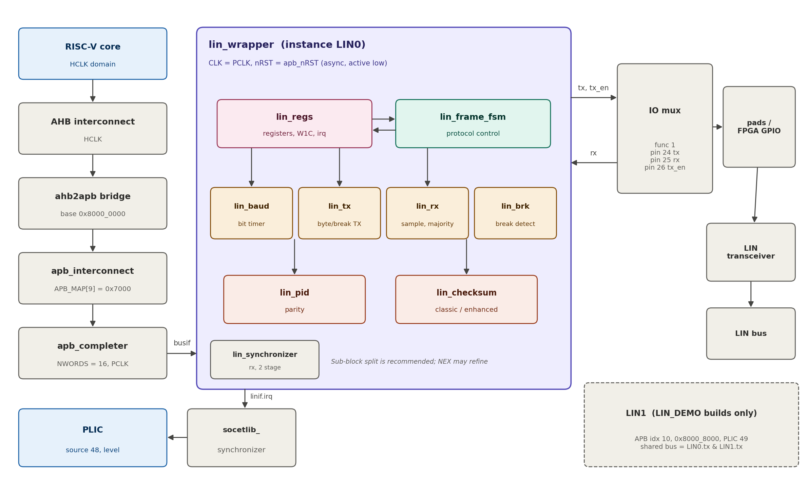
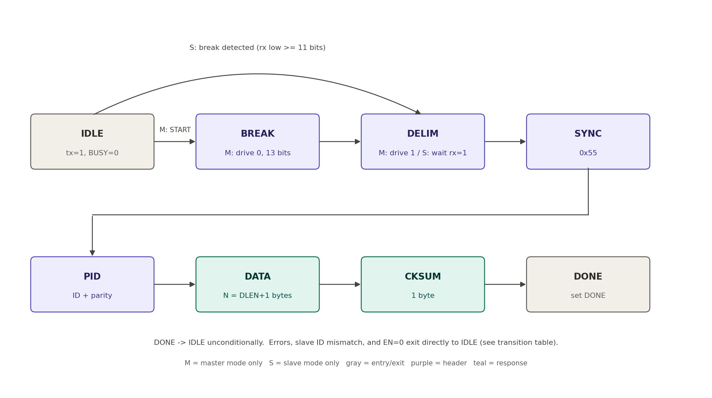

| | |
|-----------------------|------------------------------------------------------------|
| **Team / Group** | System-on-Chip Extension Technologies (SoCET) — Digital Design – AI Application Team |
| **Author** | Chris Park |
| **Course** | VIP 47920 |
| **Target device** | AFTx07 RISC-V SoC (APB peripheral) |
| **Status** | Draft v0.5.1. Baseline approved by advisor. All repository integration details resolved; no blocking open items (Appendix A). |
| **Implementation flow** | SystemVerilog RTL → checkpoint harness in Verilator ≥ 5 (milestones 1–4) → remaining unit tests and coverage in a user-chosen simulator (milestone 5) → SoC-level regression → FPGA (DE2-115) |
| **Downstream use** | Normative input for the NEX RTL agent: Specification (this document) → Microarchitecture → RTL. |

# 0. Document Conventions

- **Normative language.** "shall" is mandatory. "should" is recommended. "may" is optional. Text without these words is informative.
- **Requirement IDs.** Every normative requirement has an ID `LIN-<AREA>-<NN>`. Microarchitecture, RTL comments, and test cases shall cite these IDs.
- **Accepted defaults.** Two values could not be read from the repository and are fixed by decision: the ASIC PCLK frequency and the `apb_completer` wen/ren pulse width. Appendix A records both. Neither affects RTL correctness.
- **Time units.** T_clk is one PCLK period. T_bit = DIV × T_clk, where DIV is BAUD.DIV. N is the number of response data bytes (1–8).
- **Bit numbering.** Register bit 0 is the LSB. Bytes on the LIN wire are sent LSB first.
- **Partitioning.** Externally visible behavior (ports, registers, wire timing, protocol, status semantics, SoC integration) is normative. The internal sub-module split in Section 13.3 is a recommendation that the microarchitecture may refine without changing external behavior.

## 0.1 Revision History

| Version | Changes |
|----------|------------------------------------------------------------|
| v0.1 | Initial draft. |
| v0.2 | Advisor feedback resolved: single-ID filtering in baseline; complete STATUS set/clear rules; single divider replaces OVERSAMPLE; PID_ERR added; DLEN = N−1; DELIM state; response timeout corrected to 14×(N+1) T_bit; wired-AND testbench bus; write protection while BUSY. |
| v0.3 | Repository integration resolved. APB peripheral on PCLK with asynchronous active-low reset. Module renamed `lin_wrapper` with ports `CLK, nRST, busif, linif` to match `spi_wrapper`. APB index 9 at 0x8000_7000 with NWORDS = 16. PLIC source 48 through `DEFINE_INTERRUPT`. IO mux function 1 on pins 24/25/26. Clock-specific DEFAULT_DIV (163 on FPGA, 521 on ASIC). Bus access robustness to multi-cycle wen/ren and unaligned addresses. Second instance LIN1 under the new `LIN_DEMO` define for the FPGA two-node demo. Repository file layout, FuseSoC core, `socetlib_synchronizer` reuse, Questa then Verilator flow, and SoC-level software tests defined. |
| v0.4 | All open items closed. IO mux encoding from `pal.h`: pins 24–27 are `fsel1` bits [17:16]–[23:22], value 1 selects function 1. PLIC ID = source + 1 (`PLIC_ID()` in `pal.h`), so LIN0 is ID 49 and LIN1 is ID 50. Exact `femtokernel/pal.h` additions, `tb_aftx07.sv` (Questa SoC testbench) loopback patch, and `doc/src/memory_map.md` update added. SoC interrupt test split from the functional loopback test, because `spi_test.c` documents an unresolved APB-peripheral-to-PLIC delivery failure. ASIC PCLK and `apb_completer` pulse width recorded as accepted defaults. |
| v0.5 | Owner decision: the peripheral is self-contained. `rx` uses a LIN-local `lin_synchronizer` instead of `socetlib_synchronizer`, and every helper module (synchronizer, counter, shift register) uses a `lin_` prefix instead of a `_lin` suffix. `lin.core` no longer depends on `socet:digital-lib`. No behavioral change. |
| v0.5.1 | Verification flow only, no design change. Milestones 1–4 are accepted by the checkpoint harness (`lin/tb/checkpoint/`, Verilator); Section 14.4 steps 1–2 (Questa unit tests and coverage) move to milestone 5 in `docs/MILESTONES.md`. |

# 1. Overview

This project adds a Local Interconnect Network (LIN) controller peripheral to the AFTx07 SoC. LIN is a low-cost, single-wire, half-duplex serial bus widely used for low-bandwidth automotive and embedded subsystems such as seat controls, sensor nodes, and actuator modules. It reuses standard UART byte framing and adds a protocol layer on top: a break/sync header for bus wakeup and timing recovery, a 6-bit protected identifier that addresses one frame to one responder, a data payload of 1–8 bytes, and a checksum. The goal of this project is to implement a memory-mapped LIN controller in RTL, verify it against the LIN 2.x specification in simulation, and bring it up on FPGA driven by the AFTx07 RISC-V core.

The project is scoped for one person over one semester. It is intentionally narrower than a senior-design-track project (full AFT, Ethernet, or DisplayPort) while still requiring real protocol design, FSM design, and hardware/software integration comparable to the ECE 33700 lab flow.

# 2. Motivation

- LIN is not among the AFTx07 peripherals (GPIO, timer, PWM, SPI, UART, DMA, PLIC/CLINT); it fills a gap for low-speed multi-drop sensor/actuator buses.
- It builds on the UART framing the group already understands, keeping ramp-up manageable while still requiring real protocol and state-machine design.
- It is well specified and checksum-verifiable, which makes correctness easy to demonstrate in simulation and in a live FPGA demo.

# 3. Scope

## 3.1 Baseline (required)

- **LIN-GEN-01** The controller shall implement LIN master mode: header transmission (break, delimiter, sync, protected ID) followed by transmission or reception of the response.
- **LIN-GEN-02** The controller shall implement LIN slave mode: header reception, single-ID acceptance (one configured ID per instance), and transmission or reception of the response.
- **LIN-GEN-03** Mode shall be selected by software through CTRL.MODE. An instance operates in exactly one mode at a time.
- **LIN-GEN-04** The baud rate shall be software-configurable through BAUD.DIV and cover at least 1–20 kbps at both the FPGA PCLK (3.125 MHz) and the nominal ASIC PCLK (10 MHz).
- **LIN-GEN-05** The controller shall generate and check protected-ID parity and generate and check classic and enhanced checksums.
- **LIN-GEN-06** The controller shall be an APB peripheral of AFTx07 with a level-high interrupt connected to the PLIC.
- **LIN-GEN-07** The RTL shall simulate in Questa and shall lint cleanly and simulate in Verilator ≥ 5 (Section 13).
- **LIN-GEN-08** AFTx07 shall contain exactly one instance (LIN0) in every build except builds that define `LIN_DEMO`, which shall contain a second instance (LIN1) for the two-node FPGA demo (Section 5.6).

## 3.2 Stretch goals (baseline RTL shall not depend on these)

- Multi-ID slave acceptance filtering. Register offsets 0x24–0x3C are reserved for it.
- Wake-up signal generation and detection.
- Slave automatic baud adjustment from the measured sync byte.
- Demo through a real LIN transceiver IC on a physical bus.
- A C++ LIN slave model in `top_level/tb/sim-peripherals/` for SoC-level slave and subscribe tests.

## 3.3 Out of scope

Physical design and tapeout flow; hardware schedule tables (the master schedule is driven by software issuing START); sleep commands, diagnostic transport layer, and node configuration services (software-layer LIN functions); multiple masters on one bus.

# 4. Background: LIN vs. UART

LIN reuses UART asynchronous byte framing (start bit, 8 data bits, 1 stop bit, bit-time-based sampling) as its physical layer and adds:

- A single-wire, half-duplex, multi-drop bus. Every node reads its own transmissions back on rx.
- A break field (13+ bit times low) and a sync byte (0x55) at the start of every frame.
- A protected identifier: a 6-bit ID plus 2 parity bits.
- A checksum (classic or enhanced) over the data.
- Master-scheduled access: only the master sends headers, so there is no collision arbitration.

## 4.1 Protocol parameters used by this design (normative)

| Parameter | Value in this design | Notes |
|---------------------------------|---------------------------------------------------|---------------------------------------------------------|
| Bus levels | 0 = dominant, 1 = recessive | Idle bus is 1. tx = 1 whenever not driving a 0. |
| Byte frame | start 0 + 8 data bits LSB first + stop 1 = 10 T_bit | No UART parity bit. |
| Break (master TX) | exactly 13 T_bit of 0 | LIN minimum 13. |
| Break detect threshold (slave RX) | 11 T_bit of continuous 0 | LIN slave threshold. |
| Break delimiter (master TX) | exactly 1 T_bit of 1 | LIN minimum 1. |
| Sync byte | 0x55 | |
| Inter-byte space | 0 T_bit when transmitting | Receivers accept any inter-byte space within the timeout. |
| Response space | 1 T_bit when transmitting a response | LIN-PROT-12. |
| Data length N | 1–8 bytes | Encoded as CTRL.DLEN = N − 1. |
| Nominal header | 34 T_bit | 13 + 1 + 10 + 10. |
| Response timeout | 14 × (N + 1) T_bit | 1.4 × 10 × (N + 1), LIN T_Response_Maximum. |
| Slave header timeout | 28 T_bit from entering SYNC | 1.4 × 20 T_bit for sync and PID bytes. |

# 5. AFTx07 System Integration

All facts in this section were taken from the AFTx07 repository (`aftx07.sv`, `aftx07_mmap.vh`, `aftx07_macros.vh`, `bus_protocol_if.sv`, `gateway.sv`, `spi_wrapper.sv`, `AFTx07.core`, `aftx07_fpga.sv`, `pinmap.tcl`, `tb_aftx07.cc`). Exact code changes are in Appendix B.

{width=100%}

## 5.1 Bus attachment

- **LIN-INT-01** LIN0 shall be an APB completer attached with `` `ADD_APB(lin0, LIN0_APB_IDX, 16, lin0_protif) ``, where `LIN0_APB_IDX = 9`.
- **LIN-INT-02** `APB_MAP[9] = 32'h7000`. APB map entries are offsets from the AHB-to-APB bridge base 0x8000_0000, so the CPU-visible base address of LIN0 is **0x8000_7000**.
- **LIN-INT-03** NWORDS = 16, so the window is 0x8000_7000–0x8000_703F. Accesses at offsets ≥ 0x40 are rejected with an error by `apb_completer` and never reach `lin_wrapper`.
- **LIN-INT-04** `APB_NCOMPLETERS` shall become 10 (11 in `LIN_DEMO` builds) in both the `SYNTHESIS` and non-`SYNTHESIS` branches of `aftx07_mmap.vh`. The bridge window (`NWORDS = APB_NCOMPLETERS × 4096`) and `apb_interconnect` (`COMPLETER_ADDR_BITS = 16`) already cover these offsets.

## 5.2 Clock and reset

- **LIN-INT-05** `lin_wrapper.CLK` shall be connected to `PCLK` and `lin_wrapper.nRST` to `apb_nRST`, like the other APB peripherals.
- **LIN-INT-06** The whole controller is a single clock domain (PCLK). Only `linif.rx` is asynchronous.

| Platform | HCLK | PCLK | Source |
|------------------------------------------|------------------------|-----------------------------|------------------------------------------------------------|
| FPGA (DE2-115, Cyclone IV E EP4CE115F29C7) | 25 MHz | 3.125 MHz | `aftx07_fpga.sv`: HCLK = CLOCK_50 / 2, PCLK = HCLK / 8 |
| ASIC | 80 MHz (measured) | 10 MHz (accepted default, A4) | `tb_aftx07.cc` comment and `PCLK_RATIO = 8` |
| Verilator SoC testbench | cycle-based | HCLK / 8 | `tb_aftx07.cc` `PCLK_RATIO = 8` |
| Questa SoC testbench | 31.25 MHz (period 32 ns) | HCLK / 8 | `tb_aftx07.sv`: `HCLK_PERIOD = 16`, `PCLK_PERIOD = HCLK_PERIOD * 8` |

## 5.3 Interrupt

- **LIN-INT-07** LIN0's irq shall connect to PLIC source index 48 with `` `DEFINE_INTERRUPT(lin0, 48, lin0if.irq) ``. This macro inserts a 2-stage `socetlib_synchronizer` into the HCLK domain, so no extra crossing logic is needed in `lin_wrapper`.
- **LIN-INT-08** The unused-interrupt loop `g_unused_irq` shall start at 49 (50 in `LIN_DEMO` builds) instead of `TIMER_CC_CHANNELS + 32 + 8` (= 48).
- **LIN-INT-09** The PLIC claim ID is the hardware source index plus 1, because ID 0 means "no interrupt" (`plic_core.sv`; `PLIC_ID(hw_source)` in `pal.h`). LIN0 is therefore **PLIC ID 49** (`PLIC_ID(48)`) and LIN1 is **PLIC ID 50**. Both are in enable word 1 (`enable[1]` bits 17 and 18) and pending word 1 (`pending[1]` bits 17 and 18).
- **LIN-INT-19** `aftx07.sv` does not override `INTERRUPT_TRIGGER_TYPES`, so the gateway is `ACTIVE_HIGH` (level). Two consequences follow:
  - The PLIC returns the ID on claim only if the source is still high at the claim. LIN irq stays high until software clears the flag, so this is satisfied.
  - The gateway re-triggers if the source is still high after completion. Software shall clear the LIN STATUS flag (W1C) **before** writing the PLIC completion.
- **LIN-INT-20** Software enables the interrupt with `plic_enable(PLIC, PLIC_ID(48), 0, prio)` from `femtokernel/irq.h`, with prio ≥ 1 (the default threshold is 0).

Current PLIC source allocation after this change:

| Source index | PLIC ID | Owner |
|------------|----------|----------------------------------------|
| 0–31 | 1–32 | GPIO ports 0–3 |
| 32–37 | 33–38 | SPI |
| 38 | 39 | DMA |
| 39–46 | 40–47 | Timer capture/compare |
| 47 | 48 | Timer TC |
| **48** | **49** | **LIN0** |
| 49 | 50 | LIN1 (`LIN_DEMO` only), otherwise unused |
| 50–63 | 51–64 | unused (tied 0) |

## 5.4 Pins

- **LIN-INT-10** LIN0 pins shall use IO mux function 1 on pins 24–26, which currently have no function-1 user. Function 0 (GPIO) is unchanged.

| IO mux pin | Function 1 signal | Direction | Function 1 output_enable | `fsel1` field | `pal.h` macro | DE2-115 FPGA pin |
|----------|----------------------------------|----------|------------------------|-------------|---------------------|-------------------|
| 24 | LIN0 tx | out | 1 | [17:16] = 1 | `IOM_F1_LIN0_TX` | GPIO[24] = PIN_AH25 |
| 25 | LIN0 rx | in | 0 | [19:18] = 1 | `IOM_F1_LIN0_RX` | GPIO[25] = PIN_AE25 |
| 26 | LIN0 tx_en | out | 1 | [21:20] = 1 | `IOM_F1_LIN0_TX_EN` | GPIO[26] = PIN_AG22 |
| 27 | Demo bus monitor (`LIN_DEMO` only) | out | 1 | [23:22] = 1 | `IOM_F1_LIN_DEMO_BUS` | GPIO[27] = PIN_AE24 |

Pins 24–27 were chosen because:

- both SoC testbenches toggle pins 0–7 (`tb_aftx07.cc` every 10,000 cycles, `tb_aftx07.sv` every 500);
- `pal.h` reserves function-1 names on pins 0–3 (UART, I2C);
- pins 4–23 are used by SPI, PWM, and the timer.

IO mux encoding (from `femtokernel/pal.h` `IOMuxRegBlk`): `fsel0` at 0x8000_5000 covers pins 0–15 and `fsel1` at 0x8000_5004 covers pins 16–31. Each pin has a 2-bit field at bit 2·(pin mod 16), and value 1 selects function 1 (the left element of the `DEFINE_PIN` concatenation).

- **LIN-INT-11** Software shall select function 1 on pins 24–26 **before** setting CTRL.EN = 1, using a read-modify-write of `fsel1` so the timer pins (16–23) are not disturbed: `iomux->fsel1 = (iomux->fsel1 & ~(0x3F << 16)) | IOM_F1_LIN0_TX | IOM_F1_LIN0_RX | IOM_F1_LIN0_TX_EN;`. Until then, rx may read 0, which a slave would treat as a break.

## 5.5 Build integration

- **LIN-INT-12** The peripheral shall live in a new top-level directory `lin/` with layout `lin/lin.core`, `lin/src/*.sv`, and `lin/tb/*`, following the `interrupt_controller/plic` pattern (`src/`, `tb/`).
- **LIN-INT-13** `lin/lin.core` shall be a CAPI=2 core named `socet:aft:lin:0.1.0` that depends only on `socet:bus-components:bus_protocol_if` (no `socet:digital-lib` dependency; LIN-RTL-08), with targets `default` (RTL only), `sim` (Questa default; Verilator via `--binary --timing`), and `lint` (Verible with `--rules_config_search`).
- **LIN-INT-14** `AFTx07.core` shall add `"socet:aft:lin"` to the `rtl` dependency list and declare a new boolean `vlogdefine` parameter `LIN_DEMO`. The `fpga` target shall set `LIN_DEMO=true`. The `sim` and `syn` targets shall not set it by default.

## 5.6 FPGA two-node demo (`LIN_DEMO`)

- **LIN-INT-15** When `LIN_DEMO` is defined, AFTx07 shall also instantiate LIN1: an identical `lin_wrapper` at `APB_MAP[10] = 32'h8000` (CPU base **0x8000_8000**), NWORDS = 16, PLIC source 49.
- **LIN-INT-16** In `LIN_DEMO` builds the two instances share an internal wired-AND bus: `lin_demo_bus = lin0if.tx & lin1if.tx`, and both `lin0if.rx` and `lin1if.rx` are driven from it. Pin 25 is ignored in this mode. `lin_demo_bus` is also driven on IO mux pin 27 function 1 for logic-analyzer observation.
- **LIN-INT-17** Without `LIN_DEMO`, `lin0if.rx` is driven from IO mux pin 25 function 1, and pin 27 keeps its original definition.

## 5.7 Default baud divider

- **LIN-INT-18** `aftx07_mmap.vh` shall define `localparam int LIN_DEFAULT_DIV`: **163** when `QUARTUS` is defined (19,172 baud at 3.125 MHz, −0.15%), otherwise **521** (19,194 baud at 10 MHz, −0.03%). Every `lin_wrapper` instance is passed `.DEFAULT_DIV(LIN_DEFAULT_DIV)`.

# 6. `lin_wrapper` Interface

## 6.1 Module, parameter, ports

- **LIN-IF-01** The top module of the peripheral shall be `lin_wrapper` in `lin/src/lin_wrapper.sv`.

```systemverilog
module lin_wrapper #(
    parameter int unsigned DEFAULT_DIV = 521   // reset value of BAUD.DIV
)(
    input  logic CLK,                          // PCLK
    input  logic nRST,                         // apb_nRST, asynchronous, active low
    bus_protocol_if.peripheral_vital busif,
    lin_if.peripheral linif
);
```

- **LIN-IF-11** The interface `lin_if` shall be defined in `lin/src/lin_if.sv`:

```systemverilog
interface lin_if;
    logic tx;     // to IO mux / transceiver TXD; registered; 1 = recessive
    logic tx_en;  // transceiver enable; registered copy of CTRL.EN
    logic rx;     // from IO mux / transceiver RXD; asynchronous to CLK
    logic irq;    // level-high interrupt; registered
    modport peripheral (input rx, output tx, tx_en, irq);
    modport soc        (output rx, input tx, tx_en, irq);
endinterface
```

| Signal | Dir (peripheral) | Reset value | Description |
|------------------------------------|----------------|-----------|------------------------------------------------------------|
| CLK | in | — | PCLK. |
| nRST | in | — | Asynchronous active-low reset. |
| busif.addr[31:0] | in | — | Byte offset from the instance base (apb_completer subtracts the base). |
| busif.wen, busif.ren | in | — | Write and read request. |
| busif.wdata[31:0], busif.strobe[3:0] | in | — | Write data and byte enables. |
| busif.rdata[31:0] | out | — | Read data. |
| busif.error, busif.request_stall | out | 0 | Tied to 0. |
| linif.rx | in | — | Async LIN receive line. |
| linif.tx | out | 1 | LIN transmit line. |
| linif.tx_en | out | 0 | Transceiver enable. |
| linif.irq | out | 0 | Level-high interrupt. |

## 6.2 Bus behavior

- **LIN-IF-02** The register is selected by `busif.addr[5:2]`. `busif.addr[1:0]` is ignored; sub-word accesses are handled with `busif.strobe`.
- **LIN-IF-03** `busif.addr` is the byte offset from the instance base; `apb_completer` subtracts `BASE_ADDR` before the access reaches `lin_wrapper`.
- **LIN-IF-04** `busif.rdata` shall be combinational from register state while `busif.ren = 1` and 0 otherwise, as in `spi_wrapper`.
- **LIN-IF-05** `busif.error = 0` and `busif.request_stall = 0`. Every access completes without wait states.
- **LIN-IF-06** Writes honor byte lanes: lane k (bits 8k+7:8k) is written only when `busif.strobe[k] = 1`.
- **LIN-IF-07** Reads shall have no side effects.
- **LIN-IF-08** Reads of offsets 0x24–0x3C return 0; writes to them are ignored.
- **LIN-IF-09** `linif.rx` shall pass through `lin_synchronizer #(.STAGES(2), .RESET_STATE(1'b1))` before any use (2 flip-flops, reset to recessive). Ports are `.CLK, .nRST, .async_in, .sync_out`. "rx" elsewhere in this document means the synchronized signal.
- **LIN-IF-10** The design shall behave correctly if `apb_completer` holds `wen` or `ren` high for more than one CLK cycle in one APB transfer: a write repeated on consecutive cycles shall have the same effect as a single write. The rules in Section 7 already guarantee this (START is ignored once BUSY = 1, W1C is idempotent, reads have no side effects). The actual pulse width is an accepted default (Appendix A, A3); test T23 covers both cases.

# 7. Register Map

## 7.1 General rules

- **LIN-REG-01** All registers are 32 bits and word-aligned. LIN0 base 0x8000_7000; LIN1 base 0x8000_8000 (`LIN_DEMO` only).
- **LIN-REG-02** Reserved bits read 0 and ignore writes.
- **LIN-REG-03** Access types: RW = read/write; RO = read-only, writes ignored; W1C = write 1 to clear, write 0 has no effect; WS = write-1 strobe that always reads 0.
- **LIN-REG-04** While STATUS.BUSY = 1, writes to CTRL bits other than EN and all writes to BAUD, PID, TXDATA0, and TXDATA1 shall be ignored. STATUS and IRQ_EN are always writable. BUSY is evaluated in the cycle of the write.

| Offset | Name | Reset | Summary |
|----------|----------|-----------|-----------------------------------------------|
| 0x00 | CTRL | 0x0000_0000 | Enable, mode, start, response direction, length |
| 0x04 | STATUS | 0x0000_0000 | BUSY plus seven sticky W1C event flags |
| 0x08 | BAUD | DEFAULT_DIV | Bit-time divider |
| 0x0C | PID | 0x0000_0080 | Frame ID, parity (RO), checksum type |
| 0x10 | TXDATA0 | 0x0000_0000 | Response bytes 0–3 to transmit |
| 0x14 | TXDATA1 | 0x0000_0000 | Response bytes 4–7 to transmit |
| 0x18 | RXDATA0 | 0x0000_0000 | Response bytes 0–3 received (RO) |
| 0x1C | RXDATA1 | 0x0000_0000 | Response bytes 4–7 received (RO) |
| 0x20 | IRQ_EN | 0x0000_0000 | Interrupt enable per STATUS flag |
| 0x24–0x3C | — | — | Reserved; read 0, writes ignored |

## 7.2 CTRL (0x00)

| Bits | Field | Access | Reset | Description |
|----------|----------|----------|----------|------------------------------------------------------------|
| 0 | EN | RW | 0 | Controller enable. Writing 0 while BUSY aborts the frame (LIN-FSM-03). Writable while BUSY. |
| 1 | MODE | RW | 0 | 0 = master, 1 = slave. |
| 2 | START | WS | 0 | Master only. Writing 1 starts a frame if, after this write is applied, EN = 1, MODE = 0, and BUSY = 0. Otherwise ignored with no flag. Ignored in slave mode. |
| 3 | TX_RESP | RW | 0 | 1 = this node transmits the response and checksum (publisher). 0 = this node receives them (subscriber). |
| 6:4 | DLEN | RW | 0 | N − 1. 0 → 1 byte, 7 → 8 bytes. All values legal. |
| 31:7 | — | RO | 0 | Reserved. |

A single write may set EN, MODE, TX_RESP, DLEN, and START together; the frame then uses the newly written values.

## 7.3 STATUS (0x04)

| Bits | Field | Access | Reset | Description (full rules in Section 11) |
|----------|----------|----------|----------|-----------------------------------------------------|
| 0 | BUSY | RO | 0 | 1 while the FSM is not in IDLE. |
| 1 | DONE | W1C | 0 | Frame completed successfully. |
| 2 | CKSUM_ERR | W1C | 0 | Received checksum ≠ computed checksum. |
| 3 | TIMEOUT | W1C | 0 | Response timer or slave header timer expired. |
| 4 | BIT_ERR | W1C | 0 | While driving, sampled rx ≠ driven tx. |
| 5 | FRAME_ERR | W1C | 0 | A received byte (other than sync) had stop bit 0. |
| 6 | SYNC_ERR | W1C | 0 | Slave: sync byte ≠ 0x55, or its stop bit was 0. |
| 7 | PID_ERR | W1C | 0 | Slave: received parity bits do not match received ID. |
| 31:8 | — | RO | 0 | Reserved. |

## 7.4 BAUD (0x08)

| Bits | Field | Access | Reset | Description |
|----------|----------|----------|-----------|------------------------------------------------------------|
| 15:0 | DIV | RW | DEFAULT_DIV | CLK cycles per LIN bit (T_bit = DIV × T_clk), used for TX and RX. A written value below 16 is stored as 16. |
| 31:16 | — | RO | 0 | Reserved. |

## 7.5 PID (0x0C)

| Bits | Field | Access | Reset | Description |
|----------|----------|----------|----------|------------------------------------------------------------|
| 5:0 | ID | RW | 0 | Master: identifier to send. Slave: the single identifier accepted. |
| 6 | P0 | RO | 0 | ID0 ^ ID1 ^ ID2 ^ ID4, computed continuously. |
| 7 | P1 | RO | 1 | ~(ID1 ^ ID3 ^ ID4 ^ ID5), computed continuously. |
| 8 | CKSUM_TYPE | RW | 0 | 0 = classic (data only). 1 = enhanced (PID byte plus data). |
| 31:9 | — | RO | 0 | Reserved. |

PID[7:0] as read is the protected identifier byte exactly as sent on the wire. Software selects classic checksum for diagnostic IDs 0x3C and 0x3D; hardware applies CKSUM_TYPE as written.

## 7.6 TXDATA0/1 (0x10, 0x14) and RXDATA0/1 (0x18, 0x1C)

| Register | 31:24 | 23:16 | 15:8 | 7:0 |
|-----------------|----------|----------|----------|----------|
| TXDATA0 / RXDATA0 | byte 3 | byte 2 | byte 1 | byte 0 |
| TXDATA1 / RXDATA1 | byte 7 | byte 6 | byte 5 | byte 4 |

- **LIN-REG-05** Byte 0 is the first data byte on the wire. Only bytes 0 to N−1 are sent or received.
- **LIN-REG-06** RXDATA0/1 shall be cleared to 0 on entry to DATA when TX_RESP = 0. Data byte k shall be written to byte k in the cycle its stop bit completes (LIN-RX-05), regardless of later errors. Bytes N–7 stay 0. RXDATA is unchanged when TX_RESP = 1.
- **LIN-REG-07** RXDATA is a complete, checksum-valid response only when STATUS.DONE was set by that frame.

## 7.7 IRQ_EN (0x20)

| Bits | Field | Access | Reset | Description |
|----------|----------|----------|----------|------------------------------------|
| 0 | — | RO | 0 | Reserved (BUSY cannot interrupt). |
| 7:1 | EN[7:1] | RW | 0 | Bit k enables STATUS bit k onto irq. |
| 31:8 | — | RO | 0 | Reserved. |

# 8. Bit Timing and Baud Rate

A single divider sets the bit time for both directions. The receiver samples at clock resolution inside each bit, with no separate oversampling divider. At the slowest platform (FPGA, 3.125 MHz PCLK) a 19.2 kbps bit is 163 clocks, which is more resolution than a 16× oversampling scheme provides.

## 8.1 Divider

- **LIN-BAUD-01** One bit time is exactly DIV CLK cycles for TX and RX. Baud = f_PCLK / DIV.
- **LIN-BAUD-02** Legal DIV range is 16–65535. Written values below 16 are stored as 16.
- **LIN-BAUD-03** DIV is constant during a frame (write-protected while BUSY, LIN-REG-04).

| Target baud | DIV @ 3.125 MHz (FPGA) | Error | DIV @ 10 MHz (ASIC) | Error |
|-----------|----------------------|----------|-------------------|----------|
| 2400 | 1302 | +0.006% | 4167 | −0.008% |
| 9600 | 326 | −0.147% | 1042 | −0.032% |
| 10417 | 300 | −0.003% | 960 | −0.003% |
| 19200 | 163 | −0.147% | 521 | −0.032% |
| 20000 | 156 | +0.160% | 500 | 0.000% |

All entries are within the LIN master clock tolerance of ±0.5%. For simulation speed, software tests should use DIV between 16 and 64 (Section 14.4).

## 8.2 Transmit timing

- **LIN-BAUD-04** Each transmitted bit holds tx for exactly DIV CLK cycles. Bytes are back-to-back: a byte is 10 × DIV cycles, a break 13 × DIV cycles of 0, a delimiter 1 × DIV cycles of 1.
- **LIN-BAUD-05** tx shall be driven directly from a flip-flop.

## 8.3 Receive sampling

Let h = floor(DIV/2) and q = floor(DIV/16). Bit period k of a byte (k = 0 start, 1–8 data LSB first, 9 stop) covers cycles [k·DIV, (k+1)·DIV), counted from the cycle in which the start-bit falling edge is detected on synchronized rx.

- **LIN-RX-01** While waiting for a byte, a 1→0 transition on synchronized rx marks cycle 0 of the start bit.
- **LIN-RX-02** Each bit value is the 2-of-3 majority of rx sampled at offsets k·DIV + h − q, k·DIV + h, and k·DIV + h + q.
- **LIN-RX-03** If the start bit majority is 1, it is a false start: discard it with no flag and return to waiting.
- **LIN-RX-04** If the stop bit majority is 0, the byte has a framing error (reported per Section 9.5).
- **LIN-RX-05** A byte is complete in the cycle of its last stop-bit sample (offset 9·DIV + h + q). The receiver shall be able to detect the next start edge in the following cycle.
- **LIN-RX-06** `break_detected` asserts when synchronized rx has been 0 for 11 × DIV consecutive cycles. Any cycle with rx = 1 resets the count.

## 8.4 Bit-error monitoring

- **LIN-RX-07** Whenever the node is driving a bit (break, delimiter, or any bit of a byte it sends), it shall sample rx at offsets h − q, h, h + q of that bit, take the majority, and compare it with the driven value. A mismatch sets BIT_ERR and aborts the frame (LIN-FSM-04).

The synchronizer plus the IO mux output and input registers add a few PCLK cycles of loop delay. The mid-bit sample point tolerates loop delay up to about h − q cycles (7 cycles at DIV = 16). Hardware bring-up with a real transceiver should use DIV ≥ 64.

# 9. Frame Protocol Behavior

## 9.1 Master mode (MODE = 0)

1. Software writes CTRL.START = 1 (preconditions in 7.2). The FSM leaves IDLE and BUSY = 1.
2. BREAK: drive 0 for 13 T_bit.
3. DELIM: drive 1 for 1 T_bit.
4. SYNC: send byte 0x55.
5. PID: send byte PID[7:0] = {P1, P0, ID[5:0]}.
6. TX_RESP = 1: wait 1 T_bit with tx = 1 (response space), then send TXDATA bytes 0 to N−1 and the computed checksum, back-to-back.
7. TX_RESP = 0: receive N bytes into RXDATA, then receive the checksum byte and compare. The response timeout applies.
8. On success, the DONE state sets STATUS.DONE and the FSM returns to IDLE.

## 9.2 Slave mode (MODE = 1) and ID filtering

Baseline filtering is single-ID. PID.ID holds the one identifier this node accepts, and CTRL.TX_RESP and CTRL.DLEN describe that frame. Software configures them while BUSY = 0.

1. In IDLE with EN = 1 and MODE = 1, the break detector runs. Received bytes and framing errors are ignored in IDLE.
2. When `break_detected` asserts, go to DELIM (BUSY = 1) and wait until rx = 1. There is no timeout here; a permanently low bus is recovered by writing EN = 0.
3. SYNC: start the 28 T_bit header timer and receive one byte. If the stop bit is 1 and the value is 0x55, go to PID. Otherwise go to IDLE and set SYNC_ERR.
4. PID: receive one byte.
   - Bad stop bit → IDLE, set FRAME_ERR.
   - Parity bits [7:6] do not match bits [5:0] → IDLE, set PID_ERR.
   - Received ID[5:0] ≠ PID.ID → IDLE, no flag.
   - Otherwise → DATA.
5. DATA and CKSUM behave as master steps 6–7. An enhanced checksum uses the received PID byte.
6. On success, DONE sets STATUS.DONE and the FSM returns to IDLE, where it listens for the next break.

- **LIN-PROT-01** Header timer expiry in SYNC or PID → IDLE, set TIMEOUT.
- **LIN-PROT-02** In slave mode, `break_detected` in SYNC, PID, DATA, or CKSUM abandons the frame with no flag and goes to DELIM. A data byte cannot trigger this, because its longest dominant run is 9 T_bit.
- **LIN-PROT-03** The baseline slave does not adjust its bit rate from the sync byte. Both nodes must use the same DIV.

## 9.3 Protected identifier

- **LIN-PROT-04** P0 = ID0 ^ ID1 ^ ID2 ^ ID4. P1 = ~(ID1 ^ ID3 ^ ID4 ^ ID5). PID byte = {P1, P0, ID5..ID0}.

| ID | 0x00 | 0x01 | 0x10 | 0x23 | 0x3C | 0x3D | 0x3F |
|----------|----------|----------|----------|----------|----------|----------|----------|
| PID byte | 0x80 | 0xC1 | 0x50 | 0xA3 | 0x3C | 0x7D | 0xBF |

## 9.4 Checksum

- **LIN-PROT-05** Seed s = 0 for classic and s = the PID byte for enhanced. For each data byte d in order: s = s + d; if s > 255 then s = s − 255. Checksum = ~s (8 bits).
- **LIN-PROT-06** A received response is valid if and only if the received checksum byte equals the checksum computed over the received data bytes.
- **LIN-PROT-07** The accumulator is seeded on entry to DATA, before the first data byte.

| Data bytes | Type | PID byte | Checksum |
|-----------|----------|--------------|----------|
| 4A 55 93 E5 | classic | — | 0xE6 |
| 4A 55 93 E5 | enhanced | 0xA3 (ID 0x23) | 0x43 |
| 01 | classic | — | 0xFE |
| 01 | enhanced | 0x50 (ID 0x10) | 0xAE |
| FF FF | classic | — | 0x00 |

## 9.5 Error definitions

| Flag | Detected when | Applies in |
|----------|------------------------------------------------------------|------------------------------------------------------------|
| BIT_ERR | Sampled rx ≠ driven tx on any bit this node drives (LIN-RX-07). | Master: BREAK, DELIM, SYNC, PID. Both modes: DATA/CKSUM with TX_RESP = 1. |
| FRAME_ERR | Stop bit majority = 0 on a received byte. | Slave: PID. Both modes: DATA/CKSUM with TX_RESP = 0. |
| SYNC_ERR | Received sync ≠ 0x55, or its stop bit = 0. | Slave: SYNC. |
| PID_ERR | Received parity bits do not match the received ID. | Slave: PID. |
| CKSUM_ERR | Received checksum ≠ computed, with a valid stop bit. | Both modes: CKSUM with TX_RESP = 0. |
| TIMEOUT | Response timer or slave header timer expired. | Response timer: DATA/CKSUM with TX_RESP = 0. Header timer: slave SYNC/PID. |

## 9.6 Timers

- **LIN-PROT-08** The response timer starts on entry to DATA when TX_RESP = 0 and stops on exit from CKSUM. It expires no earlier than 14·(N+1)·DIV cycles and no later than (14·(N+1)+1)·DIV cycles after DATA entry.
- **LIN-PROT-09** The slave header timer starts on entry to SYNC and stops on exit from PID. It expires between 28·DIV and 29·DIV cycles after SYNC entry.
- **LIN-PROT-10** No timeout applies when TX_RESP = 1; transmit duration is deterministic and BIT_ERR covers bus faults.
- **LIN-PROT-11** If a timer expires in the same cycle a byte completes, the byte completion takes precedence.
- **LIN-PROT-12** When TX_RESP = 1, the first response start bit begins exactly 1 T_bit after the PID byte completes. For the master that is the end of its own PID stop bit; for the slave it is the cycle in which the received PID byte completes (LIN-RX-05).

# 10. Frame FSM

{width=95%}

- **LIN-FSM-01** States: `typedef enum logic [2:0] {IDLE, BREAK, DELIM, SYNC, PID, DATA, CKSUM, DONE} lin_state_t;`. Reset state IDLE.
- **LIN-FSM-02** BUSY = (state ≠ IDLE).
- **LIN-FSM-03** Priority 1, any state: if CTRL.EN = 0, go to IDLE on the next cycle. No flag is set and tx returns to 1.
- **LIN-FSM-04** Priority 2: a bit error goes to IDLE and sets BIT_ERR.
- **LIN-FSM-05** Priority 3, slave only: `break_detected` in SYNC, PID, DATA, or CKSUM goes to DELIM with no flag.
- **LIN-FSM-06** Priority 4: the transitions in Table 10.1. When several rows of the same state are true in one cycle:
  - a completed byte wins over timer expiry (LIN-PROT-11);
  - for a completed byte, a bad stop bit wins over the sync-value, parity, ID, and checksum checks;
  - a parity mismatch wins over an ID mismatch.
- **LIN-FSM-07** Every frame that leaves IDLE ends in exactly one of three ways: DONE set; exactly one error flag set; or silent termination (slave ID mismatch, EN = 0 abort, or LIN-FSM-05 resynchronization).

## 10.1 Transition table

| From | To | Condition (M = master, S = slave) | Action |
|-----------|----------|------------------------------------------------|------------------------------------------------------------|
| IDLE | BREAK | M: START accepted | Begin driving 0. |
| IDLE | DELIM | S: EN = 1 and break_detected | — |
| BREAK | DELIM | M: 13 T_bit elapsed | Begin driving 1. |
| DELIM | SYNC | M: 1 T_bit elapsed. S: rx = 1 | M: start sending 0x55. S: start header timer. |
| SYNC | PID | M: 0x55 sent. S: byte = 0x55 with valid stop bit | M: start sending the PID byte. |
| SYNC | IDLE | S: byte ≠ 0x55 or bad stop bit | Set SYNC_ERR. |
| SYNC, PID | IDLE | S: header timer expired | Set TIMEOUT. |
| PID | DATA | M: PID sent. S: valid stop, parity OK, ID match | Seed checksum. If TX_RESP = 0: clear RXDATA and start response timer. |
| PID | IDLE | S: bad stop bit | Set FRAME_ERR. |
| PID | IDLE | S: parity mismatch | Set PID_ERR. |
| PID | IDLE | S: parity OK, ID ≠ PID.ID | None (silent). |
| DATA | DATA | Byte k < N−1 completed (TX or RX) | Accumulate checksum. RX: store byte k. |
| DATA | CKSUM | Byte N−1 completed | Accumulate. TX: start sending checksum. |
| DATA, CKSUM | IDLE | TX_RESP = 0: bad stop bit | Set FRAME_ERR. |
| DATA, CKSUM | IDLE | TX_RESP = 0: response timer expired | Set TIMEOUT. |
| CKSUM | DONE | TX: checksum sent. RX: checksum matches | — |
| CKSUM | IDLE | RX: checksum mismatch | Set CKSUM_ERR. |
| DONE | IDLE | Unconditional, 1 cycle | Set DONE. |

## 10.2 Per-state outputs

| State | tx driven by | Receiver activity | Timers |
|----------|-----------------------------------------------|--------------------------------------------|---------------------|
| IDLE | 1 | S: break detector only | — |
| BREAK | 0 | Bit-error monitor | Bit timer |
| DELIM | 1 | M: bit-error monitor. S: wait for rx = 1 | M: bit timer |
| SYNC | M: byte TX. S: 1 | M: bit-error monitor. S: byte RX | S: header |
| PID | M: byte TX. S: 1 | M: bit-error monitor. S: byte RX | S: header |
| DATA | TX_RESP = 1: response space, then bytes. Else 1 | TX_RESP = 1: bit-error monitor. Else byte RX | TX_RESP = 0: response |
| CKSUM | TX_RESP = 1: checksum byte. Else 1 | As DATA | As DATA |
| DONE | 1 | — | — |

# 11. Status Flags and Interrupt

## 11.1 Flag lifecycle

| Flag | Set by | Cleared by | Not cleared by |
|---------------------------------------------------------|----------------------------------|---------------------------------|--------------------------------------------------|
| BUSY | FSM leaving IDLE | FSM entering IDLE (hardware only) | Any software write |
| DONE | DONE → IDLE transition | W1C to bit 1; reset | New frame, EN = 0, reads |
| CKSUM_ERR, TIMEOUT, BIT_ERR, FRAME_ERR, SYNC_ERR, PID_ERR | The error transition in Table 10.1 | W1C to that bit; reset | New frame, EN = 0, reads, a later successful frame |

- **LIN-STAT-01** STATUS bits 7:1 are sticky until a W1C write or reset.
- **LIN-STAT-02** A W1C write clears only the bits written as 1 in byte lane 0 (requires `strobe[0] = 1`).
- **LIN-STAT-03** If hardware sets a flag in the same cycle software clears it, the flag is set at the end of that cycle (set wins).
- **LIN-STAT-04** Flags are not cleared automatically when a new frame starts. Software clears bits 7:1 before START (master) or after handling each frame (slave).

## 11.2 Outcome invariant

From LIN-FSM-07: after any frame, at most one bit of STATUS[7:1] is newly set. If BUSY falls and no new bit is set, the frame ended silently.

## 11.3 Interrupt

- **LIN-IRQ-01** `linif.irq` shall be registered, level-high, and equal to `|(STATUS[7:1] & IRQ_EN[7:1])` as of the previous cycle (1-cycle latency).
- **LIN-IRQ-02** irq stays high until every enabled, set flag is cleared or its enable is cleared.
- **LIN-IRQ-03** irq reaches the PLIC through `DEFINE_INTERRUPT` (LIN-INT-07) as PLIC ID 49 (LIN1: 50). The ISR order is: PLIC claim → read STATUS → handle → W1C STATUS → PLIC complete (LIN-INT-19).

# 12. Software Programming Sequences (informative)

Software uses the `femtokernel/pal.h` definitions added in Appendix B.6 (`LINRegBlk`, `LIN0_BASE`, `IOM_F1_LIN0_*`, `LIN0_IRQ_SRC`) and the helpers in `femtokernel/irq.h` and `riscv.h` (`plic_enable`, `interrupt_enable`, `wait_flag_timeout`), following `sw-tests/spi_test.c`.

```c
LINRegBlk   *lin   = (LINRegBlk *)LIN0_BASE;
IOMuxRegBlk *iomux = (IOMuxRegBlk *)IO_MUX_BASE;
PLICRegBlk  *PLIC  = (PLICRegBlk *)PLIC_BASE;
```

**Pin setup (always first, LIN-INT-11)**

```c
iomux->fsel1 = (iomux->fsel1 & ~(0x3F << 16))
             | IOM_F1_LIN0_TX | IOM_F1_LIN0_RX | IOM_F1_LIN0_TX_EN;
```

**Master publishes (master sends the data)**

1. Write `lin->baud`, then `lin->irq_en` if interrupts are used.
2. Write `lin->pid` with the ID, OR'd with `LIN_PID_CKSUM_ENH` for an enhanced checksum.
3. Write `lin->txdata0` and `lin->txdata1`.
4. Write `lin->status = LIN_ST_EVENTS` to clear old flags.
5. Write `lin->ctrl = LIN_CTRL_EN | LIN_CTRL_TX_RESP | LIN_CTRL_DLEN(N) | LIN_CTRL_START`.
6. Poll until `lin->status & LIN_ST_EVENTS` is non-zero, or take the interrupt. Read status, then write the set bit back to clear it.

**Master subscribes (a slave sends the data)**

Same as above with TX_RESP = 0 and no TXDATA write. On DONE, read `lin->rxdata0` and `lin->rxdata1`.

**Slave**

1. Write `baud`, `pid` (accepted ID and checksum type), `txdata` if publishing, and `irq_en`.
2. Write `ctrl = LIN_CTRL_EN | LIN_CTRL_MODE | [LIN_CTRL_TX_RESP] | LIN_CTRL_DLEN(N)` with no START. The node then services every matching frame on its own.
3. On each event: read status; if DONE and TX_RESP = 0, read rxdata; update txdata while BUSY = 0; then W1C.

**Interrupt setup and handler**

```c
volatile uint32_t lin_event = 0;

void __attribute__((interrupt)) mext_handler() {
    uint32_t id = PLIC->cfg[0].claim_complete;          // claim
    if (id == PLIC_ID(LIN0_IRQ_SRC)) {
        lin_event = lin->status & LIN_ST_EVENTS;
        lin->status = lin_event;                         // W1C first (LIN-INT-19)
    }
    PLIC->cfg[0].claim_complete = id;                    // then complete
}

// in main():
lin->irq_en = LIN_ST_EVENTS;
plic_enable(PLIC, PLIC_ID(LIN0_IRQ_SRC), 0, 7);
interrupt_enable();
```

# 13. RTL Implementation Constraints

## 13.1 Coding rules

- **LIN-RTL-01** Synthesizable SystemVerilog (IEEE 1800-2017 subset) accepted by Questa, Verilator ≥ 5, Quartus (Cyclone IV E), and the ASIC synthesis flow (`syn` target, Xcelium front end).
- **LIN-RTL-02** `verilator --lint-only -Wall` on `lin_wrapper` and every LIN module shall report zero warnings, or each remaining warning shall have a documented `/* verilator lint_off */` waiver with a reason. Verible lint (`lint` target) shall pass.
- **LIN-RTL-03** Use `always_ff` for sequential logic and `always_comb` for combinational logic. No latches, `initial` blocks, `#` delays, multiple drivers, or X assignments in RTL.
- **LIN-RTL-04** Single clock (CLK = PCLK). `linif.rx` is the only asynchronous input and goes only through the synchronizer in LIN-IF-09.
- **LIN-RTL-05** Every flip-flop uses an asynchronous active-low reset, `always_ff @(posedge CLK, negedge nRST)` with `if (!nRST)`, matching `spi_wrapper.sv`, and resets to the values in this document.
- **LIN-RTL-06** `linif.tx`, `linif.tx_en`, and `linif.irq` are driven directly from flip-flops.
- **LIN-RTL-07** One module per file; the file name equals the module name. All module names are snake_case.
- **LIN-RTL-08** No vendor primitives and no dependency on `socet:digital-lib`. Every helper module is LIN-local and carries a `lin_` prefix, because module names share one global namespace in the AFTx07 build. Required: `lin_synchronizer` (parameters `STAGES` ≥ 2 and `RESET_STATE`; ports `CLK, nRST, async_in, sync_out`; a plain flip-flop chain with asynchronous active-low reset). Generic counters and shift registers, if used, are named `lin_flex_counter`, `lin_shift_reg`, and so on. No LIN module may share a name with any existing repository module, including `socetlib_*`, `flex_counter_spi`, and `flex_sr_spi`.
- **LIN-RTL-09** Counter widths: bit timer ≥ 16 bits (DIV ≤ 65535); break detector ≥ 20 bits (11 × 65535 = 720,885); response timer in T_bit units ≥ 7 bits (14 × 9 = 126); header timer ≥ 5 bits (28).
- **LIN-RTL-10** Packed structs and enums may be used. Do not use `defparam`.

## 13.2 Files

| Path | Content |
|------------------------------------------------------------|------------------------------------------------------------|
| `lin/lin.core` | FuseSoC core `socet:aft:lin:0.1.0` (LIN-INT-13). |
| `lin/src/lin_if.sv` | Interface `lin_if` (LIN-IF-11). |
| `lin/src/lin_wrapper.sv` | Top module (LIN-IF-01). |
| `lin/src/lin_synchronizer.sv` | rx synchronizer (LIN-IF-09, LIN-RTL-08). |
| `lin/src/*.sv` | Sub-modules (Section 13.3) and `lin_`-prefixed helpers. |
| `lin/tb/tb_*.sv` | Self-checking unit testbenches, Questa and Verilator `--timing`. |
| `lin/tb/lin_bus_model.sv`, `lin/tb/lin_bfm.sv` | Wired-AND bus and bus-functional model (Section 14.1). |
| `lin/doc/lin.md` | Register map page for the mdBook (`doc/src/`). |
| `sw-tests/lin_regs.c`, `lin_loopback.c`, `lin_irq.c`, `lin_timeout.c` | SoC-level tests (Section 14.4). |
| `demos/lin_demo/` | FPGA two-node demo program (Section 14.4). |

## 13.3 Recommended sub-module partition (informative)

| Module | Responsibility |
|---------------|------------------------------------------------------------|
| `lin_regs` | Bus decode, registers, write protection, W1C with set-wins, irq register. |
| `lin_frame_fsm` | Section 10 FSM, byte counter, timers, flag-set pulses. |
| `lin_baud` | Bit timer: `bit_tick` every DIV cycles and sample-point strobes at h − q, h, h + q; restartable on a start edge. |
| `lin_tx` | Byte and break/delimiter transmitter; registered tx; reports bit boundaries for bit-error checking. |
| `lin_rx` | Start detection, 3-sample majority, stop check, byte-done strobe, false-start rejection. |
| `lin_brk` | Break detector (LIN-RX-06). |
| `lin_pid` | Combinational parity generate/check. |
| `lin_checksum` | Accumulator with end-around carry, seed select, final inversion. |

# 14. Verification Plan

## 14.1 Unit testbench bus model

- **LIN-VER-01** Simulated bus = `tx_A & tx_B & bfm_drv`, and every node's rx = bus (wired-AND; never cross-wired).
- **LIN-VER-02** The bus model shall support a configurable loop delay of 0 to DIV/4 cycles.
- **LIN-VER-03** The BFM shall act as master or slave and be able to inject: wrong sync byte, PID parity error, wrong checksum, stop bit forced to 0, a dominant pulse on a chosen bit, and silence.
- **LIN-VER-04** The unit testbench shall drive `bus_protocol_if` directly with single-cycle and two-cycle `wen`/`ren` pulses (LIN-IF-10).

## 14.2 Unit directed tests

| ID | Test | Pass criteria |
|----------|------------------|------------------------------------------------------------|
| T01 | Reset values | All registers match Section 7; tx = 1; tx_en = 0; irq = 0. |
| T02 | Register access | RW read-back; reserved bits read 0; strobes honored; addr[1:0] ignored; 0x24–0x3C read 0; reads have no side effects. |
| T03 | Write protection | BAUD/PID/TXDATA/CTRL (non-EN) writes ignored while BUSY; STATUS and IRQ_EN writable. |
| T04 | Master publish | N = 1–8 × classic/enhanced: wire bytes, timing (LIN-BAUD-04), checksum; DONE. |
| T05 | Master subscribe | BFM slave responds; RXDATA correct; DONE. |
| T06 | Slave subscribe | BFM master publishes to the matching ID; RXDATA correct; DONE. |
| T07 | Slave publish | Correct response and checksum on the wire; response space 1 T_bit. |
| T08 | Two-node | Two `lin_wrapper` instances on one bus, all N × checksum types × directions. |
| T09 | ID mismatch | Slave ignores the frame; BUSY falls; no flag; next matching frame accepted. |
| T10 | PID parity error | PID_ERR; FSM to IDLE. |
| T11 | Sync error | SYNC_ERR for wrong value and for bad stop bit. |
| T12 | Checksum error | CKSUM_ERR; RXDATA holds the received bytes; DONE not set. |
| T13 | Response timeout | TIMEOUT within the LIN-PROT-08 window for N = 1 and N = 8. |
| T14 | Header timeout | Slave TIMEOUT when sync or PID stalls. |
| T15 | Bit error | BIT_ERR in every driving state; tx back to 1 within 1 cycle. |
| T16 | Frame error | FRAME_ERR on a forced-low stop bit in PID, DATA, CKSUM. |
| T17 | EN abort | EN = 0 in every non-IDLE state: IDLE next cycle, no flag, tx = 1. |
| T18 | Slave resync | New break mid-response: frame abandoned silently; new header accepted. |
| T19 | W1C and set-wins | Selective clears; simultaneous set and clear leaves the flag set. |
| T20 | IRQ | irq = STATUS & IRQ_EN with 1-cycle latency; masking works. |
| T21 | DIV range | DIV = 16, 163, 521, 65535; writing 5 stores 16; DIV change between frames. |
| T22 | False start | A glitch shorter than h − q cycles produces no byte and no flag. |
| T23 | Multi-cycle access | Every T02/T03/T19 access repeated with 2-cycle wen/ren gives identical results. |

## 14.3 Coverage goals (Questa)

- 100% FSM state and transition coverage for every arc in Table 10.1, plus one reset arc.
- Every STATUS flag set and cleared at least once; irq asserted by each enabled flag.
- Cross coverage: MODE × TX_RESP × CKSUM_TYPE × DLEN (all 8 values).

## 14.4 Flow

0. **Checkpoint harness (milestones 1–4).** `lin/tb/checkpoint/run_checkpoints.sh` in Verilator is the acceptance test for milestones 1–4 (`docs/MILESTONES.md`). Steps 1–2 below apply from milestone 5.
1. **Questa unit simulation.** Run T01–T23 with self-checking SystemVerilog testbenches through the `lin.core` `sim` target (FuseSoC `modelsim` tool) or `vlog`/`vsim` directly. Collect coverage.
2. **Verilator unit run.** `verilator --lint-only -Wall` on all RTL. Re-run the same testbenches with `verilator --binary --timing`; results must match Questa. Testbenches shall avoid constructs Verilator 5 does not support (no `randomize()` with constraints, no covergroups in shared code, no program blocks). Coverage is collected in Questa only.
3. **SoC-level regression (Verilator; also runnable in Questa through `tb_aftx07.sv`).** Build with `./build.sh`. Add tests under `sw-tests/` (header `// @test: category=lin harts=1 cycles=N`; return 0 = pass). Both SoC testbenches get a LIN loopback with pull-up from pin 24 to pin 25 (Appendix B.4, B.5). All tests use DIV = 16, so one frame with N = 8 takes about 125 × 16 × 8 = 16,000 HCLK cycles.
   - **`lin_regs.c`** (`cycles=200000`) — reset values, read-back of RW fields, reserved bits read 0, W1C behavior, all from the CPU at 0x8000_7000.
   - **`lin_loopback.c`** (`cycles=400000`) — polling only, no interrupts. Master publish over loopback for N = 1 and N = 8, classic and enhanced: STATUS reads exactly DONE each time, with no error flags. This proves the controller works independently of the PLIC path.
   - **`lin_irq.c`** (`cycles=400000`) — the same publish with `IRQ_EN.DONE` set and PLIC ID 49 enabled, structured like `spi_test.c` (CLINT re-arm handler plus `wait_flag_timeout`). On timeout it shall print three values and return 1:
     - `lin->status`;
     - bit 17 of `PLIC->pending[1]` (ID 49);
     - the result of one polled read of `PLIC->cfg[0].claim_complete`.

     These localize the failure:
     - DONE clear → controller fault; `lin_loopback` should also fail.
     - DONE set but pending clear → synchronizer or gateway path.
     - pending set but no handler entry → CPU external-interrupt delivery.

     `spi_test.c` documents an unresolved failure of exactly this kind for SPI (an APB peripheral reaching the PLIC through the same `DEFINE_INTERRUPT` path). If `lin_irq` fails with "DONE set but pending clear" while `lin_loopback` passes, the LIN RTL is not at fault: record the failure as a known SoC issue alongside `spi_test` instead of changing LIN RTL.
   - **`lin_timeout.c`** (`cycles=200000`) — master subscribe with N = 1 and no responder: STATUS reads exactly TIMEOUT.

   Slave-mode and subscribe-success paths are covered by unit tests T05–T08 and by the FPGA demo; a C++ slave model is a stretch goal.
4. **FPGA.** Build the `fpga` target (sets `SYNTHESIS`, `QUARTUS`, `LIN_DEMO`). A program in `demos/lin_demo/` configures LIN0 as master and LIN1 as slave, exchanges frames in both directions, and prints results over the existing UART console. The shared bus is observable on GPIO[27] (PIN_AE24).
5. **Stretch.** Without `LIN_DEMO`, connect pins 24/25/26 to a LIN transceiver (TJA1027 or MCP2003) and use DIV ≥ 64.

# 15. References

- LIN Specification Package, Revision 2.2A, LIN Consortium.
- AFTx07 repository: `top_level/src/aftx07.sv`, `aftx07_mmap.vh`, `aftx07_macros.vh`, `bus_protocol_if.sv`, `doc/src/bus_system.md`, `spi/…/spi_wrapper.sv`, `interrupt_controller/plic/src/gateway.sv`, `AFTx07.core`, `fpga/aftx07_fpga.sv`, `fpga/pinmap.tcl`, `top_level/tb/tb_aftx07.cc`, `top_level/tb/tb_aftx07.sv`, `interrupt_controller/plic/src/plic.sv`, `plic_core.sv`, `femtokernel/pal.h`, `femtokernel/irq.h`, `sw-tests/spi_test.c`, `sw-tests/uart_test.c`, `doc/src/memory_map.md`.
- ECE 33700 Lab 4: flex counter and FSM design/verification methodology.

# Appendix A. Resolved Items and Accepted Defaults

All items are closed. A1, A2, and A5–A7 were resolved from repository sources. A3 and A4 could not be read from the repository and are fixed by decision; neither affects RTL correctness.

| # | Item | Resolution | Source | Status |
|----------|-----------------------------------|------------------------------------------------------------|----------------------------------------------------|----------------|
| A1 | IO mux function select | `fsel1` (0x8000_5004) covers pins 16–31 with 2 bits per pin; value 1 selects function 1. Pins 24/25/26/27 are bits [17:16]/[19:18]/[21:20]/[23:22]. | `femtokernel/pal.h` (`IOMuxRegBlk`, `IOM_F*` macros) | Resolved |
| A2 | PLIC claim ID | ID = source + 1. LIN0 = 49, LIN1 = 50. | `plic_core.sv`, `pal.h` `PLIC_ID()` | Resolved |
| A3 | `apb_completer` wen/ren pulse width | Not read. Design behaves identically for 1- and 2-cycle pulses (LIN-IF-10); T23 verifies both. | Decision | Accepted default |
| A4 | ASIC PCLK frequency | 10 MHz assumed (HCLK 80 MHz / 8). Only affects the reset value of BAUD.DIV; software always writes BAUD before use. | Decision | Accepted default |
| A5 | Software header location | `femtokernel/pal.h`; register blocks are `<Name>RegBlk`, bases are `<NAME>_BASE`, bit macros use `(1<<n)`. | User; `pal.h` | Resolved |
| A6 | Questa SoC testbench | `top_level/tb/tb_aftx07.sv`; toggles all 32 pad inputs every 500 HCLK. Loopback patch in B.5. | `tb_aftx07.sv` | Resolved |
| A7 | PLIC trigger type | Not overridden in `aftx07.sv`, so the default `ACTIVE_HIGH` (level) applies. | `plic.sv`, `aftx07.sv` | Resolved |

# Appendix B. Integration Changes (reference code)

These are exact edits to existing files. NEX shall produce them as patches alongside the new `lin/` directory.

## B.1 `top_level/src/aftx07_mmap.vh`

Apply in **both** the `ifndef SYNTHESIS` and `else` branches. Place the `LIN_DEFAULT_DIV` block once, outside the branches.

```systemverilog
`ifdef QUARTUS
    localparam int LIN_DEFAULT_DIV = 163;   // 19.2 kbps @ PCLK 3.125 MHz
`else
    localparam int LIN_DEFAULT_DIV = 521;   // 19.2 kbps @ PCLK 10 MHz
`endif

// inside each branch:
localparam int LIN0_APB_IDX = 9;
`ifdef LIN_DEMO
    localparam int LIN1_APB_IDX = 10;
    localparam int APB_NCOMPLETERS = 11;
    localparam logic [31:0] APB_MAP[APB_NCOMPLETERS] = '{
        32'h0, 32'h100, 32'h200, 32'h300, 32'h1000, 32'h2000,
        32'h4000, 32'h5000, 32'h6000, 32'h7000, 32'h8000 };
`else
    localparam int APB_NCOMPLETERS = 10;
    localparam logic [31:0] APB_MAP[APB_NCOMPLETERS] = '{
        32'h0, 32'h100, 32'h200, 32'h300, 32'h1000, 32'h2000,
        32'h4000, 32'h5000, 32'h6000, 32'h7000 };
`endif
// (remove the old APB_NCOMPLETERS = 9 and the old APB_MAP)
```

## B.2 `top_level/src/aftx07.sv`

```systemverilog
// with the other bus_protocol_if declarations
bus_protocol_if lin0_protif();
lin_if          lin0if();
logic           lin0_rx_pad;

// with the other APB peripherals
lin_wrapper #(.DEFAULT_DIV(LIN_DEFAULT_DIV)) LIN0 (
    .CLK(PCLK), .nRST(apb_nRST), .busif(lin0_protif), .linif(lin0if)
);
`ADD_APB(lin0, LIN0_APB_IDX, 16, lin0_protif)
`DEFINE_INTERRUPT(lin0, 48, lin0if.irq)

// replace the existing DEFINE_PIN lines for pins 24, 25, 26
`DEFINE_PIN(24, {dummy[8],    gpio_in[24]}, {lin0if.tx,    gpio_out[24]}, {1'b1, gpio_oe[24]})
`DEFINE_PIN(25, {lin0_rx_pad, gpio_in[25]}, {1'b0,         gpio_out[25]}, {1'b0, gpio_oe[25]})
`DEFINE_PIN(26, {dummy[10],   gpio_in[26]}, {lin0if.tx_en, gpio_out[26]}, {1'b1, gpio_oe[26]})

`ifdef LIN_DEMO
    bus_protocol_if lin1_protif();
    lin_if          lin1if();
    logic           lin_demo_bus;
    lin_wrapper #(.DEFAULT_DIV(LIN_DEFAULT_DIV)) LIN1 (
        .CLK(PCLK), .nRST(apb_nRST), .busif(lin1_protif), .linif(lin1if)
    );
    `ADD_APB(lin1, LIN1_APB_IDX, 16, lin1_protif)
    `DEFINE_INTERRUPT(lin1, 49, lin1if.irq)
    assign lin_demo_bus = lin0if.tx & lin1if.tx;   // wired-AND
    assign lin0if.rx    = lin_demo_bus;
    assign lin1if.rx    = lin_demo_bus;
    // replaces the existing pin 27 line
    `DEFINE_PIN(27, {dummy[11], gpio_in[27]}, {lin_demo_bus, gpio_out[27]}, {1'b1, gpio_oe[27]})
    localparam int LIN_FIRST_UNUSED_IRQ = 50;
`else
    assign lin0if.rx = lin0_rx_pad;
    `DEFINE_PIN(27, {dummy[11], gpio_in[27]}, {1'b0, gpio_out[27]}, {1'b0, gpio_oe[27]})
    localparam int LIN_FIRST_UNUSED_IRQ = 49;
`endif

// change the unused-interrupt loop start
for (i = LIN_FIRST_UNUSED_IRQ; i < 64; ++i) begin : g_unused_irq
    `DEFINE_INTERRUPT(i, i, 0);
end
```

`dummy[9]` becomes unused; the top level already builds with `-Wno-lint`.

## B.3 `AFTx07.core`

```yaml
# filesets.rtl.depend: add
            - "socet:aft:lin"
# targets.fpga.parameters: add
            - LIN_DEMO=true
# parameters: add
    LIN_DEMO:
        description: Instantiate a second LIN controller (LIN1) on an internal shared bus for the FPGA two-node demo
        datatype: bool
        paramtype: vlogdefine
```

## B.4 `top_level/tb/tb_aftx07.cc` (inside the main loop, after the existing `io_mux_to_module_iopad` toggle block)

```cpp
// LIN0 loopback with pull-up: pin 25 (rx) sees pin 24 (tx) when driven, else recessive
{
    uint32_t pins   = dut.io_mux_to_module_iopad;
    bool     driven = (dut.io_mux_output_en_ff >> 24) & 1u;
    bool     bus    = driven ? ((dut.io_mux_from_module_ff >> 24) & 1u) : true;
    dut.io_mux_to_module_iopad = (pins & ~(1u << 25)) | (uint32_t(bus) << 25);
}
```

## B.5 `top_level/tb/tb_aftx07.sv` (Questa SoC testbench)

The `initial` block currently assigns `io_mux_to_module_iopad` as a whole word. Route that stimulus through a new variable and drive bit 25 from the loopback:

```systemverilog
// add next to the existing declarations
logic [31:0] iopad_stim;
logic        lin_bus;
assign lin_bus = io_mux_output_en_ff[24] ? io_mux_from_module_ff[24] : 1'b1;  // pull-up
assign io_mux_to_module_iopad = {iopad_stim[31:26], lin_bus, iopad_stim[24:0]};

// in the initial block: replace every
//     io_mux_to_module_iopad = <value>;
// with
//     iopad_stim = <value>;
```

`io_mux_from_module_ff` is registered inside the IO mux, so this creates no combinational loop.

## B.6 `femtokernel/pal.h`

Add in the matching sections of the file, following its existing style:

```c
// Peripheral memory map (after IO_MUX_BASE)
#define LIN0_BASE           ((uint32_t)0x80007000)
#define LIN1_BASE           ((uint32_t)0x80008000)   // LIN_DEMO builds only

// IO Mux alternate pin functions (fsel1: pins 16-31, 2 bits/pin, 1 = function 1)
#define IOM_F1_LIN0_TX      (1<<16)  // pin 24
#define IOM_F1_LIN0_RX      (1<<18)  // pin 25
#define IOM_F1_LIN0_TX_EN   (1<<20)  // pin 26
#define IOM_F1_LIN_DEMO_BUS (1<<22)  // pin 27, LIN_DEMO builds only

// LIN constants
#define LIN0_IRQ_SRC        48       // hw source; PLIC ID = PLIC_ID(48) = 49
#define LIN1_IRQ_SRC        49       // LIN_DEMO builds only; PLIC ID 50
// Control register fields
#define LIN_CTRL_EN         (1<<0)
#define LIN_CTRL_MODE       (1<<1)
#define LIN_CTRL_START      (1<<2)
#define LIN_CTRL_TX_RESP    (1<<3)
#define LIN_CTRL_DLEN(n)    ((((n) - 1) & 0x7) << 4)   // n = 1..8 data bytes
// Status register fields (bits 7:1 are write-1-to-clear)
#define LIN_ST_BUSY         (1<<0)
#define LIN_ST_DONE         (1<<1)
#define LIN_ST_CKSUM_ERR    (1<<2)
#define LIN_ST_TIMEOUT      (1<<3)
#define LIN_ST_BIT_ERR      (1<<4)
#define LIN_ST_FRAME_ERR    (1<<5)
#define LIN_ST_SYNC_ERR     (1<<6)
#define LIN_ST_PID_ERR      (1<<7)
#define LIN_ST_EVENTS       (0xFE)
// PID register fields
#define LIN_PID_ID(id)      ((id) & 0x3F)
#define LIN_PID_CKSUM_ENH   (1<<8)

// LIN register block
typedef struct {
    __IO uint32_t ctrl;     // 0x00
    __IO uint32_t status;   // 0x04
    __IO uint32_t baud;     // 0x08
    __IO uint32_t pid;      // 0x0C
    __IO uint32_t txdata0;  // 0x10
    __IO uint32_t txdata1;  // 0x14
    __I  uint32_t rxdata0;  // 0x18
    __I  uint32_t rxdata1;  // 0x1C
    __IO uint32_t irq_en;   // 0x20
} LINRegBlk;
```

Also extend the hardware-source list in the comment above `PLIC_ID` with "LIN0 48, LIN1 49 (LIN_DEMO)".

## B.7 `doc/src/memory_map.md`

Replace the last row of the APB map table with:

| Range | Bus | Peripheral |
|-----------------------|----------|----------------------------------------|
| 0x80006000 - 0x80006FFF | APB | GPIOBOOT |
| 0x80007000 - 0x8FFFFFFF | APB | LIN0 (registers 0x80007000 - 0x8000703F) |

In `LIN_DEMO` builds, LIN0 ends at 0x80007FFF and the table gains a row for LIN1 at 0x80008000 - 0x8FFFFFFF (registers 0x80008000 - 0x8000803F). Accesses outside a LIN register window return a bus error from `apb_completer`.

## B.8 Repository facts NEX relies on

```systemverilog
// bus_protocol_if (socet:bus-components) -- modport used by lin_wrapper
modport peripheral_vital (
    input  wen, ren, addr, wdata, strobe,   // addr is the OFFSET from BASE_ADDR
    output rdata, error, request_stall
);
// widths: ADDR_WIDTH = 32, DATA_WIDTH = 32, strobe = 4 bits

// PLIC (interrupt_controller/plic): ID = hw source + 1; level (ACTIVE_HIGH) gateway;
// claim returns the ID only if the source is still high; offsets: priority 0x0,
// pending 0x1000, enable 0x2000 (+0x80/context), threshold 0x200000, claim/complete 0x200004

// IO mux: fsel0 @ 0x80005000 (pins 0-15), fsel1 @ 0x80005004 (pins 16-31), 2 bits/pin,
// value 1 = function 1 = left element of DEFINE_PIN's {func1, func0} concatenations

// lin_synchronizer (LIN-local, lin/src/lin_synchronizer.sv) -- same port shape as socetlib_synchronizer
lin_synchronizer #(.STAGES(2), .RESET_STATE(1'b1)) u_sync (
    .CLK(CLK), .nRST(nRST), .async_in(linif.rx), .sync_out(rx_sync));
```
